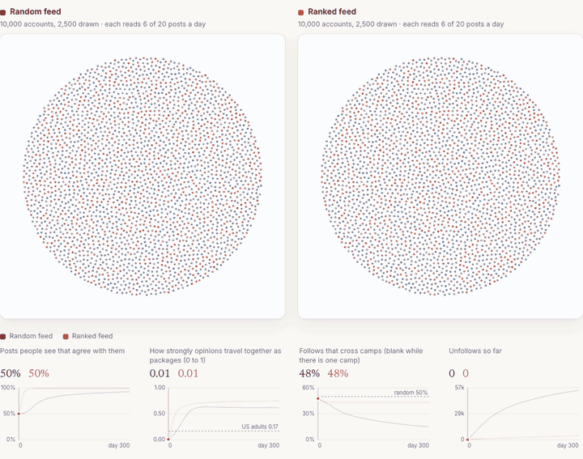
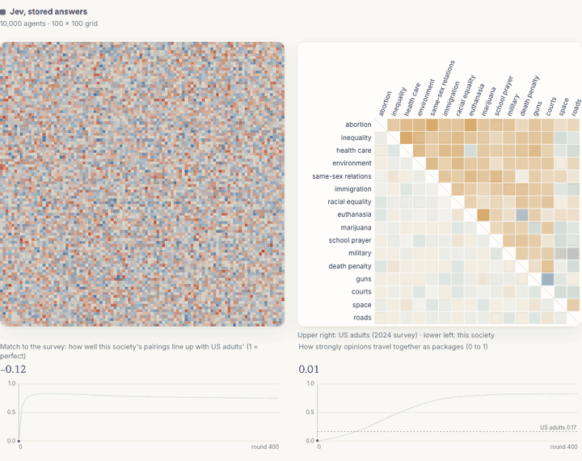
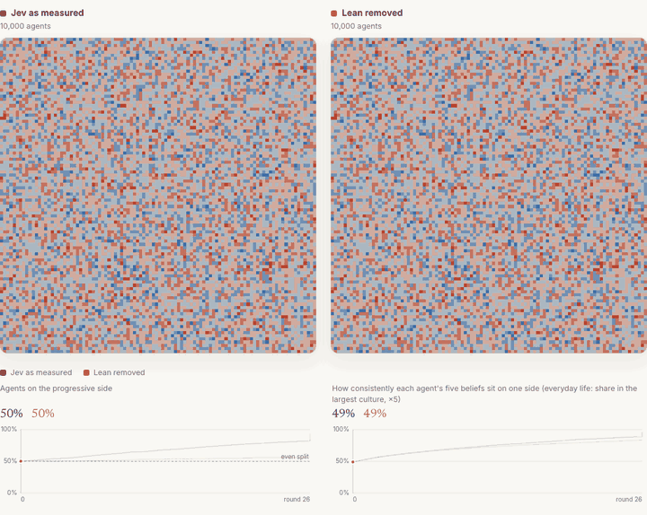

# jevSociety

**In a 10,000-account simulated social network, a feed ranked by predicted likes always hides disagreement (87–99.6% of
posts seen agree with the reader, vs 52–93% on a random feed) and cuts unfollows 11–36 times; whether it also polarizes
opinions flips with the assumptions.**

The only judge of which opinions fit together is [Jev](https://docs.typesafe.ai), TypeSafe's non-generative judgment
model, asked live for every like and every change of mind. The feed ranking is the only thing that differs between the
two societies.



Live demo: https://jev-society.vercel.app

## Results

| Question | Answer | Number |
| - | - | - |
| Does a ranked feed keep people apart? | It always hides disagreement and stops unfollowing. Whether it polarizes opinions more is not robust. | Agreeing posts 87–99.6% (ranked) vs 52–93% (random); 11–36× fewer unfollows. Sorting with Jev's lean removed: 0.83 ranked vs 0.98 random; with stubborn agents: 0.24 ranked vs 0.08 random. |
| Which opinions end up bundled together? | The same ones US adults bundle, because Jev's pairwise judgments already encode them. | Issue-pair correlations match the 2024 General Social Survey at r = 0.82 (10,000 agents, 3 seeds) and 0.84 (live Jev, 4 seeds); 0.00–0.01 with meaning removed or shuffled. |
| Which side wins? | Whichever side the judge leans toward. | Jev picks the conservative side 60.5% of the time; removing that lean ends both feeds at 50/50. In the earlier belief model, a 14.6-point lean moves the progressive share from 31% (reversed) to 82% (as measured). |

Ranges are over four settings (as measured, lean removed, stubborn agents, both), 3–10 seeds each, 10,000 accounts, 300
days, live Jev. Sources: `data/fair_results.json`, `viewer/runs/fair_summary.js`, `data/bundle_results.json`,
`viewer/runs/sweep.js`.

## How it works

Each of 10,000 accounts holds one side of 16 political issues (each matched to a GSS 2024 item), follows 20 others and,
every day:

1. **Posts** one of its positions at random.
2. **Reads** 6 of the 20 posts from the accounts it follows. *Random feed*: any 6 (every post in a day is equally new, so a
   newest-first feed reduces to this). *Ranked feed*: the 6 it is most likely to like.
3. **Likes** a post with P(fit): the probability, from Jev, that the post's statement fits its other 15 positions better
   than the opposite statement. The ranked feed uses the same P(fit) as its prediction.
4. **Adopts** a post's position it disagrees with: interacts with probability equal to the share of issues it shares with
   the author (Axelrod homophily), then switches with P(fit).
5. **Unfollows** (probability 0.05) the author of a disagreeing post it did not like, and follows someone a followee liked
   (80%) or a random account (20%).
6. **Drifts**: with probability 0.002 flips one random issue.
7. **Goes quiet** on an issue when under 30% of its feed agrees with it there (spiral of silence); it keeps the position.

Both feeds start from the same seed: same accounts, positions (independent coin flips, so no two issues correlate on day
0) and random follow network. Differences are paired. Every P(fit) is a cached Jev answer: the cache
(`data/jev_live_fit.json`) holds all 524,288 possible questions (16 issues × 2^15 combinations of the other positions).

Code: `jevsociety/netsim.py` (model), `jevsociety/live10k.py` (10,000-account runs), `jevsociety/fair.py` (fair tests).

## Fair tests

The first runs showed the random-feed society turning almost entirely conservative and the ranked feed preserving a
minority. Two objections: Jev itself leans conservative, and nothing in the model keeps opinions diverse. Four settings
test them (10,000 accounts, live Jev, 300 days, mean over seeds):

- **Lean removed.** Over all 2^15 contexts, Jev picks the conservative side of a partisan issue with probability 0.605
  (11 of 14 partisan issues above 0.5). P_sym(x | S) = (P(x | S) + P(not x | not S)) / 2, where not S flips the other
  15 positions, makes the judge treat a context and its mirror image identically; the mean becomes exactly 0.500.
- **Stubborn agents.** Each day, with probability s = 0.26, an agent moves one changed position back to its day-0 side
  (Friedkin–Johnsen-style anchoring). 0.26 is the smallest value on a 0.02 grid that keeps the random-feed society diverse
  in all 3 seeds.
- **Tilted start.** Each starting position is liberal with probability q = 0.52, 0.55 or 0.60 instead of 0.5.

| Day 300 (random / ranked) | Seeds | Leaning liberal | Sorting, mean \|r\| (US 0.17) | Posts seen that agree | Follows across camps | Unfollows |
| - | - | - | - | - | - | - |
| As measured | 10 | 10% / 32% | 0.62 / 0.75 | 93% / 99% | 15% / 43% | 52,470 / 4,676 |
| Lean removed | 10 | 50% / 50% | **0.98 / 0.83** | 81% / 99.6% | 18% / 50% | 126,705 / 3,545 |
| Stubborn agents | 3 | 28% / 14% | **0.08 / 0.24** | 57% / 87% | 36% / 23% | 119,592 / 8,527 |
| Stubborn, lean removed | 3 | 49% / 50% | 0.05 / 0.42 | 52% / 88% | 46% / 49% | 125,354 / 9,252 |
| 60% liberal start | 3 | 91% / 65% | 0.60 / 0.75 | 93% / 99% | 15% / 45% | 14× fewer ranked |

What holds:

1. **The conservative takeover is Jev's lean, not the feed.** With the lean removed both feeds end 50/50 in 10 of 10 seeds.
   The lean is worth about a 5-point head start: from a 55% liberal start both feeds end near 50/50.
2. **The random feed amplifies whichever side starts ahead; the ranked feed freezes the start.** From a 60% liberal start
   the random-feed society ends 91% liberal, the ranked one 65%. An account's day-0 positions predict its final camp better
   under the ranked feed (Cohen's kappa 0.53) than the random feed (0.23).
3. **Which feed sorts opinions more depends on the setting.** Without anchoring and without the lean, the random feed
   sorts harder (0.98 vs 0.83). With anchoring, only the ranked feed sorts past US levels (0.24 vs 0.08) and it puts 43% of
   accounts in 90%+ own-camp follow bubbles (random: 11%).
4. **The exposure effect survives everything.** The ranked feed always shows more agreeing posts and causes far fewer
   unfollows. Minority silencing does not survive: the random feed silenced 99% of minority positions only because its
   minority was 10%; with equal camps it silences 2%.

### Supporting results

- **Live Jev at 10,000 accounts, as measured** (3 seeds to day 300, 2 more and a small-world network to day 100;
  `data/net_live10k.json`). The ranked feed reaches US-level sorting on day 7 vs day 22, ends more sorted (0.75 vs 0.62)
  and keeps the follow network mixed (43% cross-camp follows vs 15%). The random-feed society unfollows the other side
  (54,619 vs 4,497 unfollows) and 75% of its accounts end following almost only their own camp. Switching everyone to the
  random feed on day 50 does not undo the sorting (0.71 on day 300 vs 0.75 staying ranked).
- **A Meta-style experiment** (1,000 accounts, pairwise table, 10 seeds; `meta_experiment` in `jevsociety/net_suite.py`).
  After 200 days on the ranked feed, moving 10% of accounts to the random feed cuts their agreeing exposure from 99% to
  58%, the first-stage effect of Guess et al. (2023). Their opinions then move away from their camp's package with soft
  judgments (β = 4: −7.4 points) and toward it with decisive ones closer to live Jev (β = 32: +4.3 points). The β = 32 case
  agrees with the Meta finding of no depolarization.
- **Other rankers** (1,000 accounts). A bridging ranker (Ovadya and Thorburn) reaches one camp faster than the random
  feed (day 152 vs 211). Adding a bonus for angry replies sorts fast (0.38 by day 50), then collapses to one camp with 48%
  of positions never posted again.
- **Feed selectivity matters.** Showing 3 or 6 of 20 posts keeps two camps; 12 of 20 lets enough disagreement through that
  the ranked society also reaches one camp by day 300.
- **Controls.** With every P(fit) = 0.5 (no meaning) the two feeds are indistinguishable (sorting difference −0.001). With
  Jev's answers attached to the wrong sentences, the ranked feed still makes two camps, but their pattern does not match the
  survey (r = 0.02).

## Earlier results

**Issue bundling on a grid.** 10,000 agents on a grid copy a neighbour's side on one issue per round, more often when it
fits their other 15 positions (Jev's 960 cached pairwise fit judgments, `data/jev_pairs_fit.json`). They sort into camps
whose 120 issue-pair correlations match GSS 2024 at r = 0.82 when the society is as sorted as US adults.



| Condition (1,600 agents unless noted) | Seeds | r with survey at US-level sorting |
| - | - | - |
| Jev's pairwise answers alone, no simulation | – | 0.81 |
| Jev pairwise table, 10,000 agents | 3 | **0.82** (0.82–0.83) |
| Jev, live call for every switch | 4 | **0.84** (0.83–0.86) |
| Solo agents: same judge, no copying | 10 | 0.80 (0.77–0.83)\* |
| No meaning (binary Axelrod with drift) | 10 | 0.01 (−0.13–0.12)\* |
| Shuffled meaning (answers on the wrong sentences) | 10 | 0.00 (−0.10–0.22)\* |

\* Most seeds never reach US-level sorting; measured at the most sorted snapshot. Source: `data/bundle_results.json`.

The map is in the judgments: Jev's pairwise answers alone predict the survey at r = 0.81. Copying adds the strength:
solo agents settle at a sorting level of 0.08, copying agents pass the US level (0.17) at round 62 and end at 0.83. It
also captures nonpartisan issues: space and road spending go from mean |r| 0.01 to 0.70 with the other issues.

**A lean decides who wins.** In the first model (each agent holds 5 of 40 belief sentences; Jev scores agreement and
picks which belief to drop), the drop judgment leans 14.6 points toward keeping progressive beliefs. Scaling that lean
gives a dose-response curve (1,600 agents, 4 seeds, round 24; `viewer/runs/sweep.js`):

| Injected lean (points) | −14.6 | 0 | +7.3 | +14.6 (raw Jev) | +29.3 |
| - | - | - | - | - | - |
| Progressive side, mean (range) | 31% (27–36%) | 56% (49–60%) | 72% (69–74%) | 82% (78–85%) | 93% (91–94%) |



Jev leans opposite ways in different judgments: progressive in this drop judgment, conservative in the fit judgment
above. Each society's winner follows the lean of the judgment it uses.

## Limits

- **Ranked means ranked by predicted likes.** Real engagement also rewards outrage; the angry-replies ranker is one crude
  version.
- **Seeds and parameters.** 10 seeds for the main and lean-removed pairs, 3 for stubborn and tilted runs; one parameter
  set and one anchoring rule, with s chosen on the random feed. Stubborn and as-measured random-feed runs had not fully
  settled by day 300 (the smaller camp still shrank 2–5 points from day 200).
- **Easy consensus.** On a random network every account is 2–3 follows from every other; nothing models identity, media
  or elections.
- **The party map is Jev's.** The society reproduces and strengthens the pairwise structure; it does not discover it.
- **Measurement.** GSS binary recodes drop middle answers; Pearson r across 120 issue pairs mostly rewards getting the
  one liberal–conservative dimension right. The survey is used only for measurement and colouring, never by the agents.
- **Not a model of people.** 16 sentences, one judge.

## Reproduce

Python 3.9+. Everything below replays cached Jev answers and costs nothing; no API key needed.

```bash
git clone https://github.com/isaacbitran/jev-society && cd jev-society
python3 -m venv .venv && .venv/bin/pip install -r requirements.txt

.venv/bin/python -m jevsociety.netsim --ranker engagement --seed 0          # 1,000 accounts, pairwise table, about 1 s
.venv/bin/python -m jevsociety.live10k --ranker chrono --ticks 300 --budget 0.5 --no-save
                                                                            # 10,000 accounts, live Jev from the cache, about 4 minutes
.venv/bin/python -m jevsociety.fair main                                    # the fair tests (data/fair_results.json)
.venv/bin/python -m jevsociety.net_suite                                    # 1,000-account feeds, controls, Meta-style experiment, about 6 minutes
.venv/bin/python -m jevsociety.bundle_suite                                 # grid bundling, every condition and seed, about 40 s
python3 -m http.server -d viewer 8000                                       # study page at http://localhost:8000
```

CLI names: `--ranker chrono` is the random feed and `--ranker engagement` the ranked feed; `--ticks` counts days (network)
or rounds (grid). They keep their original names so recorded runs stay valid.

**Offline mock mode.** `JEV_MOCK=1` replaces every Jev call with a deterministic hash-based fake answer, writes separate
`*_mock_*` caches and spends nothing. It exercises the live code path; its results say nothing about Jev.

```bash
JEV_MOCK=1 .venv/bin/python -m jevsociety.netsim --n 200 --ticks 10 --ranker engagement --live --name mock_net
```

**Live calls and cost.** Questions not in the cache (a new population size, seed or wording) call Jev and need
`TYPESAFE_API_KEY` in `.env` (see `.env.example`); `--budget` stops a run before it spends more than that many USD.
Total Jev spend across all rounds was about USD 37: 10,000-account runs USD 5.42 (375,198 answers, about 343 input tokens
each), 400-account live runs USD 0.70, grid USD 1.40, belief-model lean study USD 29.53.

**Other assets.** `scripts/check_viewer.py OUT_DIR` checks the study page headless at 1440 and 390 px wide over HTTP;
`scripts/record_gifs.py` renders the GIFs above from it. Survey correlations: download GSS 2024 from
[gss.norc.org](https://gss.norc.org), then `python3 scripts/gss_correlations.py GSS2024.dta` (needs pandas).

**Deploy.** `vercel.json` serves `viewer/` as a static site with no build step; `.vercelignore` uploads only `viewer/`.

## Repository map

```
jevsociety/netsim.py        network model: posts, feeds and rankers, likes, adoption, unfollow, silence, live mode
jevsociety/live10k.py       10,000-account live runs and their compact viewer format
jevsociety/fair.py          fair tests: lean removed, stubborn agents, tilted starts
jevsociety/net_suite.py     1,000-account feed conditions, controls, Meta-style experiment
jevsociety/bundling.py      grid bundling model; bundle_suite.py runs every condition
jevsociety/engine.py        first belief model (5 of 40 sentences) and its lean dial; sweep.py collects the dial runs
jevsociety/jev.py           batched Jev client, spend ledger, JEV_MOCK offline mode
jevsociety/issues.py        16 issues, two statements each, GSS item and recode
data/                       Jev answers (pairwise and the full live cache), survey correlations, result files
data/bias_sweep/            raw runs behind the lean dial
viewer/                     the study page (index.html) and every run it shows (runs/, format in runs/SCHEMA-live10k.md)
scripts/                    survey correlations, viewer check, GIF recorder, run-file compactor
experiments/                prototypes of two other worlds (telephone myths, gifts and grudges)
```

## Prior work

- R. Axelrod, [The Dissemination of Culture](https://doi.org/10.1177/0022002797041002001), *J. Conflict Resolution* 41(2), 1997;
  K. Klemm et al., [Global culture: a noise-induced transition in finite systems](https://doi.org/10.1103/PhysRevE.67.045101), *Phys. Rev. E* 67, 2003.
- N. Friedkin and E. Johnsen, [Social influence and opinions](https://doi.org/10.1080/0022250X.1990.9990069),
  *J. Mathematical Sociology* 15(3–4), 1990: anchoring to initial opinions, the basis of the stubborn-agent test.
- A. Guess et al., [How do social media feed algorithms affect attitudes and behavior in an election campaign?](https://doi.org/10.1126/science.abp9364),
  *Science* 381, 2023; B. Nyhan et al., [Like-minded sources on Facebook are prevalent but not polarizing](https://doi.org/10.1038/s41586-023-06297-w),
  *Nature* 620, 2023: the 2023 Meta election studies.
- A. Ovadya and L. Thorburn, [Bridging Systems](https://arxiv.org/abs/2301.09976), 2023: the bridging ranker.
- D. DellaPosta, Y. Shi and M. Macy, [Why Do Liberals Drink Lattes?](https://doi.org/10.1086/681254), *AJS* 120(5), 2015;
  A. Goldberg and S. Stein, [Beyond Social Contagion: Associative Diffusion](https://doi.org/10.1177/0003122418797576), *ASR* 83(5), 2018;
  D. Baldassarri and A. Gelman, [Partisans without Constraint](https://doi.org/10.1086/590649), *AJS* 114(2), 2008.
- E. Noelle-Neumann, [The Spiral of Silence](https://doi.org/10.1111/j.1460-2466.1974.tb00367.x), *J. Communication* 24(2), 1974;
  G. Deffuant et al., [Mixing beliefs among interacting agents](https://doi.org/10.1142/S0219525900000078), *ACS* 3, 2000.
- Y. Chuang et al., [Simulating Opinion Dynamics with Networks of LLM-based Agents](https://arxiv.org/abs/2311.09618), 2023.

What differs here: the agents generate no text. The only channel for meaning is a set of scalar judgments, each stored
and inspectable, and every result is compared against no-meaning, shuffled-meaning and lean-removed controls.

## License

MIT. See [LICENSE](LICENSE).
